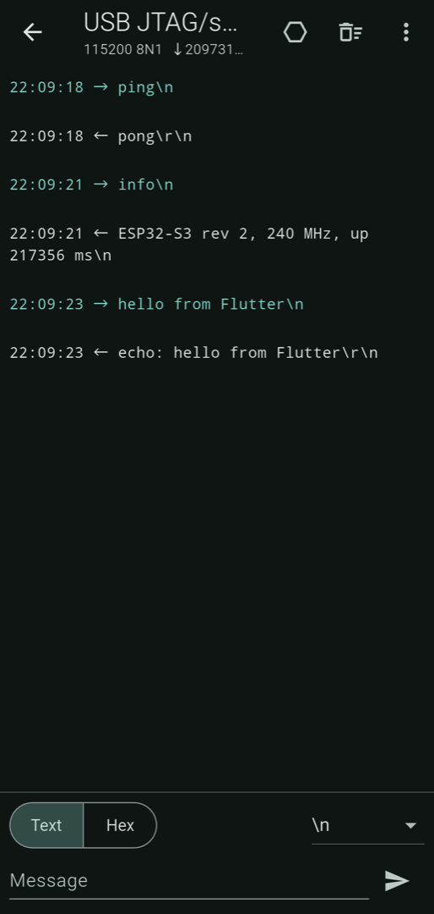

# usb_serial_next

[](https://pub.dev/packages/usb_serial_next)
[](https://github.com/Zalexei/usb_serial_next/actions/workflows/ci.yml)

Talk to Arduino and ESP32 boards, USB-UART adapters, cash registers, scales
and lab instruments from a Flutter app on Android, over USB OTG.

It is a maintained successor to [`usb_serial`](https://pub.dev/packages/usb_serial),
which has had no release since 2024-07-12 and whose JitPack dependency no
longer downloads for many people. The drivers come from
[usb-serial-for-android](https://github.com/mik3y/usb-serial-for-android)
3.11.0 (MIT), copied into the plugin: your app needs **no JitPack** or other
extra repository.

- FTDI, Silicon Labs CP210x, WCH CH34x, Prolific PL2303 (including the newer
  G and HXN chips) and every CDC-ACM device.
- Devices with several ports (FT2232H, FT4232H, CP2105) and composite devices
  such as ESP32-S3 native USB: control requests go to the right interface.
- Baud rate, data bits, parity, stop bits, flow control (RTS/CTS, DTR/DSR,
  XON/XOFF on the chips that have it), DTR, RTS, CTS/DSR/CD/RI, break, purge.
- Received data as a `Stream<Uint8List>`, plus a `lines()` helper.
- Plug and unplug events; the app can start when a known device is plugged in.
- The permission dialog that works on Android 12, 14 and later.
- Every failure is a `SerialException` with a `SerialError` value, also when
  the device is unplugged mid-transfer; nothing crashes the app.
- Works with Flutter 3.27 and newer, pure Kotlin and Java (fine with 16 KB
  memory pages).



## Speed

Measured on a Xiaomi 14T Pro (Android 16) with an ESP32-S3 on its native USB
port (USB 2.0 full speed, CDC-ACM), with the example's speed test and
`tool/esp32_echo`, 1 MB each way:

| | usb_serial_next | Same board on a Mac |
|---|---|---|
| Reading (device to phone) | 813–831 KB/s, every byte checked, none lost | 819 KB/s |
| Writing (phone to device) | 547–548 KB/s | 560 KB/s |

Both are the board's limits rather than the plugin's. Two things get there:
the plugin keeps 16 USB read requests queued (with one, reading ran at
366 KB/s) and writes in bulk transfers of up to 16 KB instead of one per
64-byte packet (writing ran at 385 KB/s). A UART bridge (CH340, CP2102, FTDI)
is limited by its baud rate instead: 921600 baud carries about 90 KB/s.

Note that the Arduino core on the ESP32-S3 drops received data when the
sketch reads slower than USB delivers it: at full speed the board kept about
55% of what was written, on the Mac as on the phone. Pace your writes or
have the device acknowledge them.

## Platforms

Android only, `minSdk` 21, `compileSdk` 35. The phone must support USB host
mode (almost all do). On other platforms `UsbSerial.isSupported` is false and
calls throw `SerialException` with `SerialError.unsupportedOperation`.

The plugin works with built-in Kotlin (AGP 9, Flutter 3.47+) and with the
Kotlin Gradle Plugin that older Flutter versions need.

## Supported chips

| Driver (`UsbSerialDriver`) | Chips | Typical boards | Flow control besides `none` |
|---|---|---|---|
| `cdcAcm` | Any CDC-ACM device, CH343, CH9102 | Arduino Uno R3/R4, Leonardo, Micro; ESP32-S2/S3/C3/C6 native USB; RP2040; STM32 VCP; modems | – |
| `ftdi` | FT232R, FT232H, FT2232H, FT4232H, FT230X, FT231X, FT234XD | FTDI cables, older Arduino | `rtsCts`, `dtrDsr`, `xonXoffInline` |
| `cp21xx` | CP2102, CP2104, CP2105, CP2108 | ESP32 DevKit, NodeMCU | `rtsCts`, `dtrDsr`, `xonXoff` |
| `ch34x` | CH340, CH341A | Cheap Arduino Nano/Uno clones, ESP32 and ESP8266 boards | – |
| `prolific` | PL2303, PL2303GC/GB/GT/GL/GE/GS (HXN) | USB-RS232 cables | `rtsCts`, `xonXoffInline` |
| `gsmModem` | Unisoc based modems (Fibocom) | | – |
| `chromeCcd` | Chromebook Closed Case Debugging | | – |

Asking for flow control the chip lacks fails with
`SerialError.unsupportedOperation`.

CDC-ACM devices are recognized by their interfaces, so a board with an
unknown VID/PID still works if it is CDC-ACM. For a vendor chip with a VID/PID
the drivers do not know, pass the driver to `open`:

```dart
await usb.open(device, driver: UsbSerialDriver.ch34x);
```

## Usage

```dart
import 'package:usb_serial_next/usb_serial_next.dart';

final usb = UsbSerial.instance;

final devices = await usb.listDevices();
final device = devices.firstWhere((d) => d.isSerial);

// Asks for permission if needed; throws SerialException if refused.
final port = await usb.open(
  device,
  config: const SerialConfig(baudRate: 115200, dtr: true),
);

port.input.listen(
  (bytes) => print('got ${bytes.length} bytes'),
  onError: (Object e) => print('ended: $e'), // SerialError.disconnected
);
await port.write([0x02, 0x10, 0x03]);
await port.close();
```

### Text and lines

```dart
port.lines().listen(print);   // UTF-8, split on \n, \r\n and \r
await port.writeText('AT\r\n');
```

`input` is a single-subscription stream: data that arrives before you listen
is kept for you. Use `lines()` or `input`, not both; call
`input.asBroadcastStream()` if several listeners need the bytes.

### Settings and control lines

```dart
await port.setConfig(const SerialConfig(
  baudRate: 9600,
  dataBits: 7,
  parity: Parity.even,
  stopBits: StopBits.one,
  flowControl: FlowControl.rtsCts,
));
await port.setDtr(true);
await port.setRts(false);
final lines = await port.getControlLines(); // cts, dsr, cd, ri; null = unknown
await port.setBreak(true);
await port.purge();
```

`SerialConfig.dtr` and `rts` set the lines while opening. Leave them `null`
to keep the adapter's state. Native USB boards (Arduino Leonardo, RP2040,
ESP32-S3) often send nothing until DTR is on; an Arduino Uno restarts when
DTR goes on, which is what the Arduino IDE does too.

### Plug and unplug

```dart
usb.deviceEvents.listen((event) {
  switch (event) {
    case UsbDeviceAttached(:final device):
      print('plugged in: $device');
    case UsbDeviceDetached(:final device):
      print('unplugged: $device'); // its ports are closed already
  }
});
```

### Writes

`write` completes when the driver has handed all bytes to the device. Its
default timeout is twice the time the bytes need at the port's baud rate,
plus one second; pass `timeout:` to change it (`Duration.zero` waits
forever). On a timeout, `SerialException.bytesWritten` says how much surely
went out (counted in steps of 16 KB).

## Errors

Every method throws `SerialException`; its `error` says what happened:

| `SerialError` | When |
|---|---|
| `permissionDenied` | The user said no, or `open(requestPermission: false)` without permission |
| `deviceNotFound` | The device is gone (unplugged before the call) |
| `unsupportedDevice` | No driver knows the device; pass `driver:` to `open` |
| `disconnected` | Unplugged while open; `input` ends with this error |
| `portClosed` | The port was closed before or during the call |
| `busy` | The port is already open, here or in another app |
| `invalidArgument` | Baud rate, data bits or port index out of range |
| `unsupportedOperation` | The chip lacks the setting (flow control, parity, break), or not Android |
| `timeout` | A write did not finish in time |
| `io` | Anything else; see `message` |

After a hot restart the plugin closes ports the previous Dart code left open,
so they are not `busy`.

## Open the app when a device is plugged in

Android can start your app when a known device is plugged in. If the user
agrees and ticks "Use by default", the app gets permission for that device
without another dialog, also after it is plugged in again. Without this,
permission lasts until the device is unplugged.

1. Add an intent filter to your activity in
   `android/app/src/main/AndroidManifest.xml`:

   ```xml
   <activity android:name=".MainActivity" android:launchMode="singleTop" ...>
       ...
       <intent-filter>
           <action android:name="android.hardware.usb.action.USB_DEVICE_ATTACHED" />
       </intent-filter>
       <meta-data
           android:name="android.hardware.usb.action.USB_DEVICE_ATTACHED"
           android:resource="@xml/device_filter" />
   </activity>
   ```

2. List the devices in `android/app/src/main/res/xml/device_filter.xml`.
   The ids are **decimal**; a `vendor-id` alone matches every product of
   that vendor:

   ```xml
   <?xml version="1.0" encoding="utf-8"?>
   <resources>
       <usb-device vendor-id="1027" />                      <!-- FTDI 0x0403 -->
       <usb-device vendor-id="4292" />                      <!-- CP210x 0x10C4 -->
       <usb-device vendor-id="6790" />                      <!-- CH34x 0x1A86 -->
       <usb-device vendor-id="1659" />                      <!-- PL2303 0x067B -->
       <usb-device vendor-id="9025" />                      <!-- Arduino 0x2341 -->
       <usb-device vendor-id="12346" />                     <!-- Espressif 0x303A -->
       <usb-device vendor-id="1155" product-id="22336" />   <!-- STM32 VCP 0483:5740 -->
   </resources>
   ```

3. Ask which device started the app:

   ```dart
   final device = await UsbSerial.instance.getLaunchDevice();
   if (device != null) {
     final port = await UsbSerial.instance.open(device); // no dialog
   }
   ```

Keep `launchMode="singleTop"` (the Flutter default): a device plugged in
while the app runs then reaches the running activity instead of starting a
second one.

## Moving from usb_serial

| `usb_serial` | `usb_serial_next` |
|---|---|
| `UsbSerial.listDevices()` | `UsbSerial.instance.listDevices()` |
| `device.vid`, `device.pid`, `device.serial` | `device.vendorId`, `device.productId`, `device.serialNumber` |
| `await device.create()` + `await port.open()` | `await UsbSerial.instance.open(device)` (asks for permission itself) |
| `device.create(UsbSerial.CH34x)` | `open(device, driver: UsbSerialDriver.ch34x)` |
| `device.create('', 1)` (interface) | `open(device, portIndex: 1)` |
| `port.setPortParameters(115200, UsbPort.DATABITS_8, UsbPort.STOPBITS_1, UsbPort.PARITY_NONE)` | `open(device, config: SerialConfig(baudRate: 115200))` or `port.setConfig(...)` |
| `port.setFlowControl(UsbPort.FLOW_CONTROL_RTS_CTS)` | `SerialConfig(flowControl: FlowControl.rtsCts)` |
| `port.setDTR(true)`, `port.setRTS(true)` | `port.setDtr(true)`, `port.setRts(true)` |
| `port.inputStream` | `port.input` (not nullable) |
| `port.write(Uint8List)` | `port.write(List<int>)` |
| `Transaction.stringTerminated(port.inputStream!, Uint8List.fromList([13, 10]))` | `port.lines()` |
| `UsbSerial.usbEventStream` with `UsbEvent.ACTION_USB_ATTACHED` | `UsbSerial.instance.deviceEvents` with `UsbDeviceAttached` / `UsbDeviceDetached` |
| `port.close()` returns `bool` | `port.close()`; `port.closed` tells why a port closed |
| `PlatformException` | `SerialException` with `SerialError` |

Remove the JitPack repository from your Gradle files if `usb_serial` was the
only reason for it.

## Architecture

`SerialPort` is the transport-neutral part: `input`, `write`, `close`,
`closed`, `lines()`, `writeText()`. It lives in
[`serial_port_core`](https://pub.dev/packages/serial_port_core), which this
package exports. `UsbSerialPort` implements it for USB and adds line settings
and control lines;
[`bluetooth_serial_next`](https://pub.dev/packages/bluetooth_serial_next)
implements it for Bluetooth Classic SPP. Code that only exchanges bytes can
take a `SerialPort` and work over either.

On the native side each open port has a reading thread with 16 queued USB
requests and a writing thread. Reads that arrive while the previous chunk is
still on its way to Dart are joined, so a fast device does not flood the main
thread.

## Tested on

- Xiaomi 14T Pro, Android 16, release build: ESP32-S3 (LilyGO T-Display-S3)
  native USB, CDC-ACM composite device. Listing, plug and unplug events,
  permission, open, reading and writing, `burst` of 1 MB without loss, DTR
  and RTS (they reset the ESP32-S3 the way esptool does), control lines,
  unplugging while open.
- Android emulator (API 37): building, the example, the "no devices" case.
- The other drivers (FTDI, CP210x, CH34x, PL2303) come unchanged from
  usb-serial-for-android 3.11.0 and were not run on hardware here.

## Example

[`example/`](https://github.com/Zalexei/usb_serial_next/tree/main/example) is a
terminal: the device list (updated on plug and unplug), line settings, sending
and receiving as text or hex with a choice of line ending, DTR and RTS
toggles, a speed test, and a device filter for starting on plug-in.
[`tool/esp32_echo`](https://github.com/Zalexei/usb_serial_next/tree/main/tool/esp32_echo)
is an ESP32 firmware that answers it.

## License

MIT. The drivers in `android/src/main/java/io/github/zalexei/usb_serial_next/usbserial`
are from [usb-serial-for-android](https://github.com/mik3y/usb-serial-for-android)
3.11.0 by Google Inc., Mike Wakerly, Kai Morich and contributors, also MIT;
see the `LICENSE.txt` and `README.md` in that folder.
